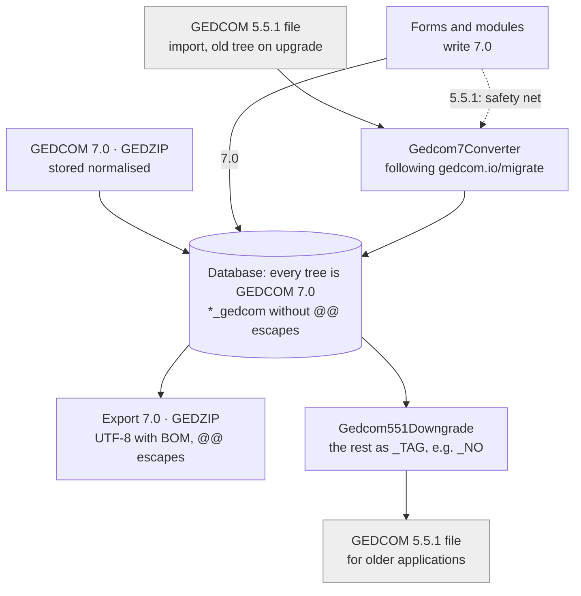

# webtrees7 – native GEDCOM 7.0: overview

As of 2026-10-18. German version: [uebersicht-gedcom7.md](uebersicht-gedcom7.md). The detailed plan and decisions
(German): [entwurf-gedcom7-native.md](entwurf-gedcom7-native.md).

webtrees7 is a private fork of webtrees (based on 2.3-dev, version 2.3.0-webtrees7) that uses GEDCOM 7.0 as its only
storage format. GEDCOM 5.5.1 exists only at the boundary: a 5.5.1 file is converted when it is imported, and the
export can still create 5.5.1.

## At a glance

webtrees 2.2 stores GEDCOM 5.5.1 and knows GEDCOM 7.0 tags only as custom tags for display. webtrees7 stores, reads,
edits, validates and exports 7.0.

| Area | webtrees 2.2 (upstream) | webtrees7 |
| --- | --- | --- |
| Storage format | GEDCOM 5.5.1 with webtrees and GEDCOM-L extensions | GEDCOM 7.0, in the same `*_gedcom` columns, without `@@` escapes |
| Import 7.0 | not supported | stored normalised, no `reformatRecord()` |
| Import 5.5.1 | stored as is | converted immediately, following [gedcom.io/migrate](https://gedcom.io/migrate/) |
| Existing 5.5.1 trees | – | converted on upgrade, after a 5.5.1 copy is saved in the data folder |
| Export | 5.5.1, ZIP with media | 7.0 (UTF-8 with BOM), GEDZIP, 5.5.1 by downgrade |
| Import GEDZIP | – | `.gdz` by upload, from the server and on the command line |
| Structure of the forms | 5.5.1 tables in `Gedcom.php` | 7.0 schema from the specification |
| Validation | “Check for errors” for 5.5.1 | validation against the 7.0 schema while typing, on save and for the whole tree |
| Notes | `NOTE` as text or pointer | `NOTE` is text only, `SNOTE` is a record, `MIME`, `LANG`, `TRAN` |
| Associates | `ASSO` + `RELA`, GEDCOM-L `_ASSO`, `_GODP`, `_WITN` | `ASSO` + `ROLE` (+ `PHRASE`), also without a record (`@VOID@`) |
| Dates and ages | `@#DJULIAN@`, `B.C.`, `INT … (…)` | `JULIAN`, `BCE`, `PHRASE` on `DATE` and `AGE` |
| Media | file path, extension, `TYPE` | `FILE` as URL, `FORM` as media type, `MEDI`, `CROP` |
| Names and places | `ROMN`, `FONE` | `TRAN` + `LANG` (BCP 47) |
| Identifiers | `AFN`, `RFN`, `RIN`, `_UID`, `_FSFTID`, `_GOV` | `EXID` + `TYPE` URI, `UID` |
| Only in 7.0 | – | `NO`, `SDATE`, `CREA`, `FAMC:STAT`, `ALIA:PHRASE`, `SCHMA`, `HEAD:LANG` |

## Storage

Every tree stores GEDCOM 7.0: every record and every pending change. There is no second column and no 5.5.1 working
copy.

- **Format.** Records are stored in `*_gedcom`, as webtrees always does, but as 7.0 and without the `@@` escapes
  ([`Gedcom7Record`](../app/Gedcom7/Gedcom7Record.php)). The export adds the escapes again.
- **Derived tables.** `dates.d_type` has the 7.0 calendar names (`GREGORIAN`, `JULIAN`, `_HIJRI` …).
  `media_file.multimedia_format` has media types such as `image/jpeg`. The name index and places read `TRAN`; `i_rin`
  comes from `EXID` with type RIN.
- **Elements always write 7.0.** Dates, ages, `RESN`, pointers to `@VOID@` and enumerations create 7.0, even without a
  tree in the context (reports, command line).
- **Safety net.** If a module or code taken from upstream still writes 5.5.1,
  [`Gedcom7Storage::pendingChange()`](../app/Gedcom7/Gedcom7Storage.php) converts it on save. Each such conversion is
  logged as “GEDCOM 5.5.1 converted to GEDCOM 7.0”.
- **Tree preference `GEDCOM7`.** It is only used during import and as a safeguard. webtrees imports a file in several
  requests, and until the end the tree temporarily contains 5.5.1 records. If a conversion fails, the tree stays
  read-only and offers a button to convert it again.
- **Own migrations.** Schema changes of the fork use `WT7_SCHEMA_VERSION` (currently 18) in
  [`app/Gedcom7/Schema/`](../app/Gedcom7/Schema), separate from Greg’s `SCHEMA_VERSION`. The target database is
  MariaDB; Greg’s test suite also runs on SQLite.



The converter is used only at the entrance and as a safety net, the downgrade only at the exit. In between, there is
no 5.5.1. Grey: files in GEDCOM 5.5.1.

## Import and conversion 5.5.1 → 7.0

The converter [`Gedcom7Converter`](../app/Gedcom7/Gedcom7Converter.php) follows the official guide
[gedcom.io/migrate](https://gedcom.io/migrate/) and loses nothing: what 7.0 does not permit in a place becomes a `_`
extension. It runs when a 5.5.1 file is imported, when existing trees are converted, and as the safety net on save.
[`Gedcom7Payload`](../app/Gedcom7/Gedcom7Payload.php) converts the payloads (dates, ages, languages, media).

| 5.5.1 / extension | becomes in 7.0 |
| --- | --- |
| Inline source (`SOUR text`) | a `SOUR` record with `TITL`/`TEXT`; the citation points to it |
| Inline media (`OBJE` without pointer) | an `OBJE` record |
| `NOTE @N1@` | `SNOTE @N1@` |
| Pointer to a missing record | `@VOID@` |
| `ASSO` + `RELA godmother` | `ASSO` + `ROLE GODP` + `PHRASE` (pastor, registrar etc. likewise to `CLERGY`, `OFFICIATOR`) |
| GEDCOM-L `_ASSO` on events | `ASSO` |
| GEDCOM-L `_GODP`, `_WITN` without a record | `ASSO @VOID@` + `PHRASE` + `ROLE GODP`/`WITN` |
| `@#DJULIAN@`, `B.C.`, `INT 1850 (Easter)`, `1648/9` | `JULIAN`, `BCE`, date + `PHRASE`, `1649` |
| `AGE CHILD`, `INFANT`, `STILLBORN` | age + `PHRASE` |
| `ROMN`, `FONE` (+ `TYPE`) | `TRAN` + `LANG` (e.g. `ja-Latn`, `ko-hang`) |
| Language names (`German`) | BCP 47 (`de`), also in GEDCOM-L `_LOC:NAME:LANG` |
| `AFN`, `RFN`, `RIN`, `_FSFTID`, `_GOV` | `EXID` + `TYPE` URI (RIN with the source application in the URI) |
| `_UID` | `UID`, value unchanged (also PAF UIDs with a checksum) |
| File path, `FORM jpg`, `TYPE photo` | `FILE` as URL (also Windows paths), `FORM image/jpeg`, `MEDI PHOTO` |
| `WAC`, `EMAI` | `INIL`, `EMAIL` |
| Old enumeration values (`DNS/CAN`, `SEALED` …) | 7.0 values (`DNS_CAN`, `SEALING` …); unknown ones as `OTHER` + `PHRASE` |
| Comma-separated name pieces | separate name pieces |
| `CONC` | joined, 7.0 has no `CONC` |

The upgrade converts existing 5.5.1 trees (migration 17,
[`Gedcom7TreeConverter`](../app/Gedcom7/Gedcom7TreeConverter.php)): first a 5.5.1 copy
`<tree>-gedcom551-<date>.ged` in the data folder, and pending changes are converted too. Large trees can be converted
beforehand on the command line:

```
php index.php tree-gedcom7
```

## Export

The export offers GEDCOM 7.0 and 5.5.1, each as `.ged` or with media. 7.0 is the normal case, 5.5.1 is for older
applications.

- **GEDCOM 7.0.** Always UTF-8 with a byte order mark, header with `GEDC:VERS 7.0`, without `CHAR`, `FILE`, `DEST`,
  `GEDC:FORM` and `SUBN`. The stored records get their `@@` escapes back. Pointers to records that are not exported
  (privacy, partial export) become `@VOID@`. `HEAD:SCHMA` from imported files is kept.
- **GEDZIP.** A `.gdz` with `gedcom.ged` and the media; `FILE` has the relative URLs in the archive. The import reads
  the same format; paths with `..` or absolute paths are skipped, existing files are kept.
- **GEDCOM 5.5.1.** [`Gedcom551Downgrade`](../app/Gedcom7/Gedcom551Downgrade.php) turns `SNOTE` back into `NOTE`
  records, `ROLE` into `RELA`, `@VOID@` + `PHRASE` for godparents and witnesses into the GEDCOM-L form `_GODP`/`_WITN`,
  `EXID` into `AFN`, `RFN`, `RIN` or `_GOV`, `TRAN` into `ROMN`/`FONE`, and media types into file extensions. Dates get
  calendar escapes; `INT … (…)` only where 5.5.1 permits phrases. What 5.5.1 does not know (`NO`, `PHRASE` elsewhere
  …) becomes a `_` extension, e.g. `_NO`. Long lines are wrapped with `CONC`.

A record survives export 7.0 → import 7.0 unchanged; the check script tests this for all test trees.

## The 7.0 structures in detail

Every 7.0 structure is read, displayed, edited and exported. The table shows what webtrees7 does with each of them.

| Structure | webtrees7 |
| --- | --- |
| `PHRASE` on `DATE`, `AGE`, pointers, enumerations | its own input field; the display shows the phrase first, e.g. “Monday after Martinmas (17 November 1750)” |
| Date forms | `JULIAN`, `FRENCH_R`, `HEBREW`, extension calendars such as `_HIJRI`; `BCE`; `NO:DATE` only as a period (`DatePeriod`) |
| `@VOID@` | “Not recorded” in every pointer selection; with `PHRASE` as the name; children without a record on the family page; an individual can be created from the phrase later |
| `ASSO` + `ROLE` | 7.0 roles (`GODP`, `WITN`, `CLERGY`, `OFFICIATOR`, `NGHBR` …), otherwise `OTHER` + `PHRASE`; the former webtrees relationships are suggestions for the phrase |
| Enumerations | `PEDI`, `NAME:TYPE`, `MEDI`, LDS status, `SOUR:EVEN:ROLE`, `RESN` all alike: 7.0 values plus “Other” = `OTHER` + `PHRASE` |
| `NO` | “event did not occur” for individuals and families, with `DATE` (period) and `SOUR`; no age in the display |
| `SNOTE` / `NOTE` | shared note as its own record type with list, page and “Used by”; `NOTE` is text only, with `MIME` (`text/html`), `LANG`, `TRAN` |
| `TRAN` + `LANG` | on names, places, notes, texts and media files; shown in the viewer’s language, the original stays visible; `HEAD:LANG` applies to texts without `LANG` |
| `FILE`, `FORM`, `MEDI` | `FILE` as URL (several per object), `FORM` as media type, `MEDI` with phrase |
| `CROP` | crops the thumbnail for each link (charts, lists, individual page) |
| `EXID` + `TYPE` | all 14 registered types from [GEDCOM-registries](https://github.com/FamilySearch/GEDCOM-registries) have a name, with a link where a URL pattern is documented (FamilySearch, Find a Grave, WikiTree); GOV on places |
| `UID` | new UIDs are UUIDs; existing ones stay unchanged |
| `FAMC:STAT`, `ALIA` + `PHRASE` | evidence status (`PROVEN`, `CHALLENGED`, `DISPROVEN`) can be edited, “?” in chart boxes, list “Evidence” |
| `SDATE` | sorts the facts, hidden in the display |
| `CREA`, `CHAN` | set by webtrees itself, not in the form |
| `SOUR:DATA:TEXT`, `SOUR:EVEN` | `TEXT` several times with `LANG`/`MIME` (transcript and translation), `EVEN` with `PHRASE` |
| `RESN` | `_NONE` for “no restriction”; on notes, sources, repositories and submitters as `_RESN`, which the privacy rules read |
| `SCHMA` | kept in the export; the admin page “Extensions” shows every `_TAG` of a tree with count, example path and URI |
| `FAM:CENS`, `FAM:RESI` | available (hidden in webtrees 2.2) |

## The schema as the foundation

The structure comes from the specification; webtrees only provides the presentation. The 5.5.1 tables of upstream no
longer define any form.

- **[`Gedcom7Schema`](../app/Gedcom7/Gedcom7Schema.php)** is generated from the machine-readable files of the
  specification ([FamilySearch/GEDCOM](https://github.com/FamilySearch/GEDCOM), `extracted-files/*.tsv`, commit
  512e38d0cd8b of 2026-09-23): record types, payloads, substructures with cardinality, enumerations. Structure types
  are the URIs `https://gedcom.io/terms/v7/<type>`.
- **[`Gedcom7Definitions`](../app/Gedcom7/Gedcom7Definitions.php)** builds the substructures with minimum and maximum
  count for every reachable path, without a depth limit. Every path without its own element gets the element of its
  structure type (178 structure types, 150 classes).
- **[`Gedcom7Elements`](../app/Gedcom7/Gedcom7Elements.php)** (939 entries) defines how webtrees shows a path where
  the structure type alone does not tell: label (“Date of birth”), order, suggestions. `gedcom551Tags()` is only used
  by the 5.5.1 export.
- **Visibility** is set by `Gedcom7Definitions::SHOWN` per structure type, no longer per 5.5.1 path. The rest appears
  with “Edit with all GEDCOM tags”; the `HIDE_*` settings apply on top.
- **Tree preferences** (fact lists, `admin/tags`) contain only 7.0 facts and `_` extensions; migration 16 has taken
  over the old values (`HIDE_NAME_ROMN` → `HIDE_NAME_TRAN` …).
- **Validation** in three places with the same rules ([`Gedcom7Problems`](../app/Gedcom7/Gedcom7Problems.php)): while
  typing in the form, on save (hints plus “Save anyway”) and in “Check for errors”. It reports missing required
  substructures, invalid values and structures that 7.0 does not permit in that place.
- **Structure view.** The menu item “Structure” shows a record as a tree of 7.0 structures, marking what is not
  permitted, missing required substructures, invalid values and extensions
  ([`Gedcom7Structure`](../app/Gedcom7/Gedcom7Structure.php)).

| Forms measured against the schema | before | now |
| --- | --- | --- |
| Paths checked | 8,772 | 16,045 |
| Missing substructures | 3,590 | 0 |
| Substructures that the schema does not have | 0 | 0 |
| Wrong cardinality | 225 | 0 |
| `registerTags()` per request | ~41 ms | ~21 ms |

## New features compared with webtrees 2.2

Besides the storage format, webtrees7 has features that only 7.0 structures make possible.

- **Source assistant** ([`AddSourceEntry`](../app/Http/Controllers/AddSourceEntry.php)). A church register entry is
  recorded once and cited for everyone in it: templates for baptism, marriage, burial and census. The result is the
  event of the main individual, the other participants as `ASSO` + `ROLE` (with or without a record), each with a
  citation `EVEN` + `ROLE`. Available from the source and from the individual.
- **Tab “Entries”** on the source page: page, event, date and participants with role, grouped by entry.
- **“Create an individual”** turns a participant without a record (`@VOID@` + `PHRASE`) into an individual and links
  it.
- **List “Evidence”** ([`EvidenceListModule`](../app/Module/EvidenceListModule.php)): challenged and disproven
  parent links, individuals that are possibly the same, events that did not occur.
- **Admin page “Extensions”** per tree: every `_TAG` with count, example path and URI from `SCHMA`.
- **Structure view** for each record, validated against the schema, with edit links.
- **Multilingual display.** Names, places and notes appear in the viewer’s language when a `TRAN` exists.
- **Image crop** by `CROP` in thumbnails.
- **Identifiers as links** for FamilySearch, Find a Grave, WikiTree and GOV.
- **GEDZIP** in both directions.
- **Convert a tree** with a button in “Manage family trees” or with `tree-gedcom7`, each with a 5.5.1 backup copy.
- **Fork identity.** The version is 2.3.0-webtrees7; webtrees7 does not check webtrees.net for upgrades, so it never
  offers Greg’s release.

## Consequences for the database, modules and interfaces

Modules that read or write raw data see 7.0. This mainly affects modules that access tables or GEDCOM text directly.

| Place | before (webtrees 2.2) | webtrees7 |
| --- | --- | --- |
| `*_gedcom` | 5.5.1 | 7.0 without `@@` escapes |
| `dates.d_type` | `@#DJULIAN@` | `JULIAN`, `_HIJRI` … (`CalendarEscape` returns the new values) |
| `media_file.multimedia_format` | `JPG` | `image/jpeg` |
| `MediaFile::filename()`, `type()` | file name, media type | unchanged; `format()` returns the media type |
| Notes | `NOTE @N1@` | `SNOTE @N1@` |
| Identifiers | `AFN`, `RFN`, `RIN`, `_UID`, `_GOV` | `EXID` + `TYPE`, `UID`, `PLAC:EXID` with the GOV URI |
| Enumerations | webtrees values | 7.0 values, the rest as `OTHER` + `PHRASE`; languages as BCP 47 |
| Restriction | `RESN none` | `RESN _NONE`; `_RESN` on notes, sources, repositories, submitters |

Whatever still writes 5.5.1 is converted by the safety net and appears in the log. The REST module api4webtrees has
been ported to webtrees7 as version 2.0.0: additive and compatible with the existing API, so the apps work unchanged
(64 of 64 tests pass). The public versions of api4webtrees and app4webtrees stay with 5.5.1.

## Validation and tests

The implementation is measured against the specification, not only against Greg’s test suite. Everything runs in
Docker with a throw-away database.

- **Test suite.** Greg’s roughly 43,000 tests plus 26 own feature tests (import, export 7.0 and 5.5.1, GEDZIP, dates,
  ages, associates, notes, translations, media, identifiers, validation, migrations). Only the 17 PDF comparisons in
  `ReportRegressionTest` fail, and they fail without any changes too. Runs on SQLite and MariaDB; phpstan reports
  nothing.
- **Independent validator** ([`docker/check-gedcom7`](../docker/check-gedcom7)) against `g7validation.json` from
  [GEDCOM-registries](https://github.com/FamilySearch/GEDCOM-registries). All 21 test files from gedcom.io import
  without errors.
- **Round trip.** Export 7.0 → import 7.0 is identical for all test trees.
- **Editor check.** Every form is rendered and submitted as a browser does and saved as webtrees does. Existing data:
  saved unchanged, the converter has nothing to do. New input: every fact of every record type, every value of every
  selection.

| Measurement | Result |
| --- | --- |
| Forms with new input | 180,642 |
| Kinds of input that the converter still has to change | 0 |
| Kinds of invalid input that validation reports first | 19 |
| Dialogs (create source, media object, note …) | 38, all 7.0 |

```
docker/check-gedcom7.sh editor
```

## Limits and open points

The data is entirely 7.0; a few places still carry webtrees 2.2 heritage or are deliberately open.

- **Tested** with Falkenrath (5.5.1, converted), maximal70 and the test files from gedcom.io, not with large trees from
  other applications.
- **Own extensions without a `SCHMA` URI.** There are no documented URIs for the tags of webtrees and GEDCOM-L, so the
  export writes no `HEAD:SCHMA` entries of its own.
- **Forms** remain fact rows on Greg’s element system, matched against the schema. There is no dedicated structure
  editor; editing raw GEDCOM remains.
- **`ASSO` under LDS ordinances** is not permitted by 7.0. Such data becomes `_ASSO` with `RELA`, and the display still
  reads this form.
- **Read-only 5.5.1 remains** in Greg’s core: `GedcomRecord` also looks for names in `ROMN`/`FONE`/`_HEB`. Harmless,
  because these tags no longer occur after conversion.
- **`QUAY`** is stored and displayed, but not evaluated. `UID` is not yet used for matching when merging.
- **PDF reports** have been adapted in places, but not systematically checked for phrases, “Not recorded” and `NO`.
- **Normalisations from upstream** remain: `MARR:TYPE civil` becomes `CIVIL`, `MARR Y` with a date loses the `Y`,
  `NAME //` becomes empty.
- **Merges from upstream** are more expensive, because views, elements, tree preferences and editors differ a lot.
  Changes to tags by Greg no longer arrive by themselves.
