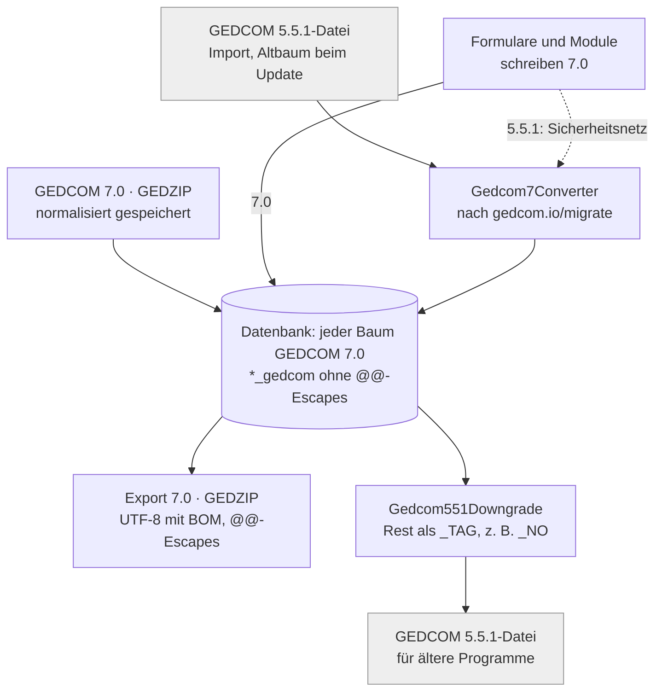

# webtrees7 – GEDCOM 7.0 nativ: Übersicht

Stand 2026-10-18. Ausführlicher Weg und Entscheidungen: [entwurf-gedcom7-native.md](entwurf-gedcom7-native.md).

webtrees7 ist ein privater Fork von webtrees (Basis 2.3-dev, Version 2.3.0-webtrees7), der GEDCOM 7.0 als einziges
Speicherformat führt. GEDCOM 5.5.1 gibt es nur noch an der Grenze: Eine 5.5.1-Datei wird beim Einlesen umgewandelt,
und der Export kann wieder 5.5.1 erzeugen.

## Auf einen Blick

webtrees 2.2 speichert GEDCOM 5.5.1 und kennt 7.0-Kennzeichen nur als benutzerdefinierte Tags zur Anzeige. webtrees7
speichert, liest, bearbeitet, prüft und exportiert 7.0.

| Bereich | webtrees 2.2 (upstream) | webtrees7 |
| --- | --- | --- |
| Speicherformat | GEDCOM 5.5.1 mit webtrees- und GEDCOM-L-Erweiterungen | GEDCOM 7.0, in denselben Spalten `*_gedcom`, ohne `@@`-Escapes |
| Einlesen 7.0 | nicht vorgesehen | normalisiert gespeichert, kein `reformatRecord()` |
| Einlesen 5.5.1 | direkt gespeichert | sofort nach [gedcom.io/migrate](https://gedcom.io/migrate/) umgewandelt |
| Vorhandene 5.5.1-Bäume | – | beim Update umgewandelt, vorher eine 5.5.1-Kopie im Datenordner |
| Export | 5.5.1, ZIP mit Medien | 7.0 (UTF-8 mit BOM), GEDZIP, 5.5.1 per Rückwandlung |
| Einlesen GEDZIP | – | `.gdz` per Upload, vom Server und über die Kommandozeile |
| Struktur der Formulare | 5.5.1-Tabellen in `Gedcom.php` | 7.0-Schema aus der Spezifikation |
| Prüfung | „Stammbaum überprüfen“ für 5.5.1 | Prüfung gegen das 7.0-Schema beim Tippen, beim Speichern und im ganzen Baum |
| Notizen | `NOTE` als Text oder Zeiger | `NOTE` nur Text, `SNOTE` als Datensatz, `MIME`, `LANG`, `TRAN` |
| Bezugspersonen | `ASSO` + `RELA`, GEDCOM-L `_ASSO`, `_GODP`, `_WITN` | `ASSO` + `ROLE` (+ `PHRASE`), auch ohne Datensatz (`@VOID@`) |
| Daten und Alter | `@#DJULIAN@`, `B.C.`, `INT … (…)` | `JULIAN`, `BCE`, `PHRASE` an `DATE` und `AGE` |
| Medien | Dateipfad, Endung, `TYPE` | `FILE` als URL, `FORM` als Medientyp, `MEDI`, `CROP` |
| Namen und Orte | `ROMN`, `FONE` | `TRAN` + `LANG` (BCP 47) |
| Kennungen | `AFN`, `RFN`, `RIN`, `_UID`, `_FSFTID`, `_GOV` | `EXID` + `TYPE`-URI, `UID` |
| Nur in 7.0 | – | `NO`, `SDATE`, `CREA`, `FAMC:STAT`, `ALIA:PHRASE`, `SCHMA`, `HEAD:LANG` |

## Datenhaltung

Jeder Baum speichert GEDCOM 7.0, jeder Datensatz und jede offene Änderung. Es gibt keine zweite Spalte und keine
Arbeitsfassung im 5.5.1-Format.

- **Speicherform.** Die Datensätze stehen wie bei webtrees üblich in `*_gedcom`, aber als 7.0 und ohne die
  `@@`-Escapes ([`Gedcom7Record`](../app/Gedcom7/Gedcom7Record.php)). Der Export setzt die Escapes wieder.
- **Ableitungstabellen.** `dates.d_type` enthält die 7.0-Kalendernamen (`GREGORIAN`, `JULIAN`, `_HIJRI` …).
  `media_file.multimedia_format` enthält Medientypen wie `image/jpeg`. Namensindex und Orte lesen `TRAN`, `i_rin`
  kommt aus `EXID` mit Typ RIN.
- **Elemente schreiben immer 7.0.** Datum, Alter, `RESN`, Zeiger auf `@VOID@` und Aufzählungen erzeugen 7.0, auch
  ohne Baum im Kontext (Berichte, Kommandozeile).
- **Sicherheitsnetz.** Schreibt ein Modul oder übernommener upstream-Code doch 5.5.1, wandelt
  [`Gedcom7Storage::pendingChange()`](../app/Gedcom7/Gedcom7Storage.php) beim Speichern um. Jeder solche Eingriff
  steht im Protokoll als „GEDCOM 5.5.1 converted to GEDCOM 7.0“.
- **Merkmal `GEDCOM7`.** Die Baumeinstellung gibt es nur noch fürs Einlesen und als Schutz. webtrees liest eine Datei
  in mehreren Anfragen ein, bis zum Ende stehen dabei vorübergehend 5.5.1-Datensätze im Baum. Scheitert die
  Umwandlung, bleibt der Baum nur lesbar und hat einen Knopf zum erneuten Umwandeln.
- **Eigene Migrationsfolge.** Schemaänderungen des Forks laufen über `WT7_SCHEMA_VERSION` (Stand 18) in
  [`app/Gedcom7/Schema/`](../app/Gedcom7/Schema), getrennt von Gregs `SCHEMA_VERSION`. Zielsystem ist MariaDB; Gregs
  Testsuite läuft zusätzlich auf SQLite.



Der Wandler sitzt nur am Eingang und als Sicherheitsnetz, die Rückwandlung nur am Ausgang. Dazwischen gibt es kein
5.5.1. Grau: Dateien im Format GEDCOM 5.5.1.

## Einlesen und Umwandlung 5.5.1 → 7.0

Der Wandler [`Gedcom7Converter`](../app/Gedcom7/Gedcom7Converter.php) folgt dem offiziellen Leitfaden
[gedcom.io/migrate](https://gedcom.io/migrate/) und verliert nichts: Was 7.0 an einer Stelle nicht erlaubt, wird eine
`_`-Erweiterung. Er läuft beim Einlesen einer 5.5.1-Datei, beim Umwandeln vorhandener Bäume und als Sicherheitsnetz
beim Speichern. Die Nutzlasten (Daten, Alter, Sprachen, Medien) wandelt
[`Gedcom7Payload`](../app/Gedcom7/Gedcom7Payload.php) um.

| 5.5.1 / Erweiterung | wird in 7.0 |
| --- | --- |
| Inline-Quelle (`SOUR text`) | eigener `SOUR`-Datensatz mit `TITL`/`TEXT`, Zitat zeigt darauf |
| Inline-Medium (`OBJE` ohne Zeiger) | eigener `OBJE`-Datensatz |
| `NOTE @N1@` | `SNOTE @N1@` |
| Zeiger auf fehlenden Datensatz | `@VOID@` |
| `ASSO` + `RELA godmother` | `ASSO` + `ROLE GODP` + `PHRASE` (Rollen wie Pastor, Standesbeamter ebenso auf `CLERGY`, `OFFICIATOR`) |
| GEDCOM-L `_ASSO` an Ereignissen | `ASSO` |
| GEDCOM-L `_GODP`, `_WITN` ohne Datensatz | `ASSO @VOID@` + `PHRASE` + `ROLE GODP`/`WITN` |
| `@#DJULIAN@`, `B.C.`, `INT 1850 (Ostern)`, `1648/9` | `JULIAN`, `BCE`, Datum + `PHRASE`, `1649` |
| `AGE CHILD`, `INFANT`, `STILLBORN` | Altersangabe + `PHRASE` |
| `ROMN`, `FONE` (+ `TYPE`) | `TRAN` + `LANG` (z. B. `ja-Latn`, `ko-hang`) |
| Sprachnamen (`German`) | BCP 47 (`de`), auch in GEDCOM-L `_LOC:NAME:LANG` |
| `AFN`, `RFN`, `RIN`, `_FSFTID`, `_GOV` | `EXID` + `TYPE`-URI (RIN mit dem Quellprogramm in der URI) |
| `_UID` | `UID`, Wert unverändert (auch PAF-UIDs mit Prüfsumme) |
| Dateipfad, `FORM jpg`, `TYPE photo` | `FILE` als URL (auch Windows-Pfade), `FORM image/jpeg`, `MEDI PHOTO` |
| `WAC`, `EMAI` | `INIL`, `EMAIL` |
| alte Aufzählungswerte (`DNS/CAN`, `SEALED` …) | 7.0-Werte (`DNS_CAN`, `SEALING` …); Unbekanntes als `OTHER` + `PHRASE` |
| kommagetrennte Namensteile | einzelne Namensteile |
| `CONC` | zusammengefasst, 7.0 kennt kein `CONC` |

Vorhandene 5.5.1-Bäume wandelt das Update um (Migration 17,
[`Gedcom7TreeConverter`](../app/Gedcom7/Gedcom7TreeConverter.php)): vorher eine 5.5.1-Kopie
`<baum>-gedcom551-<datum>.ged` im Datenordner, offene Änderungen werden mit umgewandelt. Große Bäume lassen sich
vorher auf der Kommandozeile umwandeln:

```
php index.php tree-gedcom7
```

## Export

Der Export bietet GEDCOM 7.0 und 5.5.1, jeweils als `.ged` oder mit Medien. 7.0 ist der Normalfall, 5.5.1 dient
älteren Programmen.

- **GEDCOM 7.0.** Immer UTF-8 mit Byte-Order-Mark, Kopf mit `GEDC:VERS 7.0`, ohne `CHAR`, `FILE`, `DEST`,
  `GEDC:FORM` und `SUBN`. Die gespeicherten Datensätze bekommen die `@@`-Escapes zurück. Zeiger auf Datensätze, die
  nicht im Export sind (Datenschutz, Teilexport), werden `@VOID@`. `HEAD:SCHMA` aus importierten Dateien bleibt
  erhalten.
- **GEDZIP.** Ein `.gdz` mit `gedcom.ged` und den Medien; `FILE` enthält die relativen URLs im Archiv. Der Import
  liest dasselbe Format, Pfade mit `..` oder absolute Pfade werden übergangen, vorhandene Dateien bleiben.
- **GEDCOM 5.5.1.** [`Gedcom551Downgrade`](../app/Gedcom7/Gedcom551Downgrade.php) macht aus `SNOTE` wieder
  `NOTE`-Datensätze, aus `ROLE` wieder `RELA`, aus `@VOID@` + `PHRASE` bei Paten und Zeugen die GEDCOM-L-Form
  `_GODP`/`_WITN`, aus `EXID` wieder `AFN`, `RFN`, `RIN` oder `_GOV`, aus `TRAN` wieder `ROMN`/`FONE`, aus
  Medientypen Dateiendungen. Daten bekommen Kalender-Escapes; `INT … (…)` nur, wo 5.5.1 Phrasen erlaubt. Was 5.5.1
  nicht kennt (`NO`, `PHRASE` an anderen Stellen …), wird eine `_`-Erweiterung, z. B. `_NO`. Lange Zeilen werden mit
  `CONC` umbrochen.

Ein Datensatz überlebt Export 7.0 → Import 7.0 unverändert; das prüft das Prüfskript bei allen Testbäumen.

## Die 7.0-Strukturen im Einzelnen

Jede Struktur von 7.0 wird gelesen, angezeigt, bearbeitet und exportiert. Die Tabelle nennt, was webtrees7 dabei
konkret tut.

| Struktur | webtrees7 |
| --- | --- |
| `PHRASE` an `DATE`, `AGE`, Zeigern, Aufzählungen | eigenes Eingabefeld; Anzeige zeigt den Wortlaut zuerst, z. B. „Montag nach Martini (17. November 1750)“ |
| Datumsformen | `JULIAN`, `FRENCH_R`, `HEBREW`, Erweiterungskalender wie `_HIJRI`; `BCE`; `NO:DATE` nur als Zeitraum (`DatePeriod`) |
| `@VOID@` | in allen Zeigerauswahlen als „Ohne Datensatz“; mit `PHRASE` als Name; Kinder ohne Datensatz auf der Familienseite; aus dem Wortlaut lässt sich später eine Person anlegen |
| `ASSO` + `ROLE` | 7.0-Rollen (`GODP`, `WITN`, `CLERGY`, `OFFICIATOR`, `NGHBR` …), sonst `OTHER` + `PHRASE`; die bisherigen webtrees-Beziehungen sind Vorschläge für die Phrase |
| Aufzählungen | `PEDI`, `NAME:TYPE`, `MEDI`, LDS-Status, `SOUR:EVEN:ROLE`, `RESN` einheitlich: 7.0-Werte plus „Andere“ = `OTHER` + `PHRASE` |
| `NO` | „Ereignis fand nicht statt“ bei Personen und Familien, mit `DATE` (Zeitraum) und `SOUR`; kein Alter in der Anzeige |
| `SNOTE` / `NOTE` | geteilte Notiz als eigener Datensatztyp mit Liste, Seite und „Verwendet bei“; `NOTE` nur Text, mit `MIME` (`text/html`), `LANG`, `TRAN` |
| `TRAN` + `LANG` | an Namen, Orten, Notizen, Texten und Mediendateien; Anzeige in der Sprache des Betrachters, das Original bleibt sichtbar; `HEAD:LANG` gilt für Texte ohne `LANG` |
| `FILE`, `FORM`, `MEDI` | `FILE` als URL (mehrere je Objekt), `FORM` als Medientyp, `MEDI` mit Phrase |
| `CROP` | schneidet das Vorschaubild je Verknüpfung zu (Diagramme, Listen, Personenseite) |
| `EXID` + `TYPE` | alle 14 registrierten Typen aus [GEDCOM-registries](https://github.com/FamilySearch/GEDCOM-registries) benannt, Link wo ein URL-Muster dokumentiert ist (FamilySearch, Find a Grave, WikiTree); GOV an Orten |
| `UID` | neue UIDs als UUID; vorhandene bleiben unverändert |
| `FAMC:STAT`, `ALIA` + `PHRASE` | Nachweisstand (`PROVEN`, `CHALLENGED`, `DISPROVEN`) bearbeitbar, „?“ in Diagrammkästchen, Liste „Nachweisstand“ |
| `SDATE` | sortiert die Fakten, bleibt in der Anzeige verborgen |
| `CREA`, `CHAN` | setzt webtrees selbst, nicht im Formular |
| `SOUR:DATA:TEXT`, `SOUR:EVEN` | `TEXT` mehrfach mit `LANG`/`MIME` (Abschrift und Übersetzung), `EVEN` mit `PHRASE` |
| `RESN` | `_NONE` für „keine Einschränkung“; an Notizen, Quellen, Archiven, Einsendern als `_RESN`, das der Datenschutz auswertet |
| `SCHMA` | bleibt im Export; Verwaltungsseite „Erweiterungen“ zeigt je Baum alle `_TAGS` mit Anzahl, Beispielpfad und URI |
| `FAM:CENS`, `FAM:RESI` | verfügbar (in webtrees 2.2 ausgeblendet) |

## Das Schema als Grundlage

Die Struktur kommt aus der Spezifikation, webtrees liefert nur noch die Darstellung. Die 5.5.1-Tabellen von upstream
bestimmen keine Formulare mehr.

- **[`Gedcom7Schema`](../app/Gedcom7/Gedcom7Schema.php)** ist aus den maschinenlesbaren Dateien der Spezifikation
  erzeugt ([FamilySearch/GEDCOM](https://github.com/FamilySearch/GEDCOM), `extracted-files/*.tsv`, Commit
  512e38d0cd8b vom 2026-09-23): Datensatztypen, Nutzlasten, Unterstrukturen mit Vorkommen, Aufzählungen.
  Strukturtypen sind die URIs `https://gedcom.io/terms/v7/<typ>`.
- **[`Gedcom7Definitions`](../app/Gedcom7/Gedcom7Definitions.php)** baut daraus für jeden erreichbaren Pfad die
  Unterfelder samt Mindest- und Höchstzahl, ohne Tiefengrenze. Jeder Pfad ohne eigenes Element bekommt das Element
  seines Strukturtyps (178 Strukturtypen, 150 Klassen).
- **[`Gedcom7Elements`](../app/Gedcom7/Gedcom7Elements.php)** (939 Einträge) legt fest, wie webtrees einen Pfad
  zeigt, wo der Strukturtyp allein es nicht sagt: Bezeichnung („Datum der Geburt“), Reihenfolge, Vorschlagslisten.
  `gedcom551Tags()` dient nur noch dem 5.5.1-Export.
- **Sichtbarkeit** regelt `Gedcom7Definitions::SHOWN` je Strukturtyp, nicht mehr je 5.5.1-Pfad. Der Rest erscheint
  mit „Mit allen GEDCOM-Kennzeichen bearbeiten“; die `HIDE_*`-Schalter wirken zusätzlich.
- **Baumeinstellungen** (Faktenlisten, `admin/tags`) enthalten nur noch 7.0-Fakten und `_`-Erweiterungen; Migration 16
  hat die alten Werte übernommen (`HIDE_NAME_ROMN` → `HIDE_NAME_TRAN` …).
- **Prüfung** an drei Stellen mit derselben Regelbasis ([`Gedcom7Problems`](../app/Gedcom7/Gedcom7Problems.php)):
  beim Tippen im Formular, beim Speichern (Hinweise plus „Trotzdem speichern“) und in „Stammbaum überprüfen“.
  Gemeldet werden fehlende Pflichtfelder, ungültige Werte und Strukturen, die 7.0 an dieser Stelle nicht erlaubt.
- **Strukturansicht.** Der Menüpunkt „Struktur“ zeigt einen Datensatz als Baum der 7.0-Strukturen mit Markierungen für
  nicht Erlaubtes, fehlende Pflichtfelder, ungültige Werte und Erweiterungen
  ([`Gedcom7Structure`](../app/Gedcom7/Gedcom7Structure.php)).

| Messung Formulare gegen Schema | vor dem Umbau | jetzt |
| --- | --- | --- |
| geprüfte Pfade | 8 772 | 16 045 |
| fehlende Unterfelder | 3 590 | 0 |
| Unterfelder, die das Schema nicht hat | 0 | 0 |
| falsche Anzahl | 225 | 0 |
| `registerTags()` je Anfrage | ~41 ms | ~21 ms |

## Neue Funktionen gegenüber webtrees 2.2

Neben dem Speicherformat bringt webtrees7 Funktionen, die erst mit 7.0-Strukturen möglich sind.

- **Quellen-Assistent** ([`AddSourceEntry`](../app/Http/Controllers/AddSourceEntry.php)). Ein Kirchenbucheintrag wird
  einmal erfasst und belegt alle Beteiligten: Vorlagen für Taufe, Trauung, Begräbnis und Zensus. Ergebnis ist das
  Ereignis bei der Hauptperson, die übrigen Beteiligten als `ASSO` + `ROLE` (mit oder ohne Datensatz), jede mit
  Quellenangabe `EVEN` + `ROLE`. Erreichbar von der Quelle und von der Person aus.
- **Reiter „Einträge“** auf der Quellenseite: Fundstelle, Ereignis, Datum und Beteiligte mit Rolle, je Eintrag
  zusammengefasst.
- **„Eine Person erstellen“** macht aus einem Beteiligten ohne Datensatz (`@VOID@` + `PHRASE`) eine Person und
  verknüpft sie.
- **Liste „Nachweisstand“** ([`EvidenceListModule`](../app/Module/EvidenceListModule.php)): angezweifelte und
  widerlegte Elternverbindungen, möglicherweise identische Personen, Ereignisse, die nicht stattfanden.
- **Verwaltungsseite „Erweiterungen“** je Baum: alle `_TAGS` mit Anzahl, Beispielpfad und URI aus `SCHMA`.
- **Strukturansicht** je Datensatz, gegen das Schema geprüft, mit Bearbeiten-Links.
- **Mehrsprachige Anzeige.** Namen, Orte und Notizen erscheinen in der Sprache des Betrachters, wenn eine `TRAN` dafür
  existiert.
- **Bildausschnitt** per `CROP` in Vorschaubildern.
- **Kennungen als Links** für FamilySearch, Find a Grave, WikiTree und GOV.
- **GEDZIP** in beide Richtungen.
- **Baum umwandeln** per Knopf in „Stammbäume verwalten“ oder mit `tree-gedcom7`, jeweils mit 5.5.1-Sicherungskopie.
- **Fork-Kennung.** Die Version heißt 2.3.0-webtrees7; webtrees7 fragt keine Updates bei webtrees.net ab, damit kein
  Wechsel auf Gregs Release angeboten wird.

## Folgen für Datenbank, Module und Schnittstellen

Module, die Rohdaten lesen oder schreiben, sehen 7.0. Das betrifft vor allem Module, die direkt auf Tabellen oder
GEDCOM-Text zugreifen.

| Stelle | vorher (webtrees 2.2) | webtrees7 |
| --- | --- | --- |
| `*_gedcom` | 5.5.1 | 7.0 ohne `@@`-Escapes |
| `dates.d_type` | `@#DJULIAN@` | `JULIAN`, `_HIJRI` … (`CalendarEscape` liefert die neuen Werte) |
| `media_file.multimedia_format` | `JPG` | `image/jpeg` |
| `MediaFile::filename()`, `type()` | Dateiname, Medientyp | unverändert; `format()` liefert den Medientyp |
| Notizen | `NOTE @N1@` | `SNOTE @N1@` |
| Kennungen | `AFN`, `RFN`, `RIN`, `_UID`, `_GOV` | `EXID` + `TYPE`, `UID`, `PLAC:EXID` mit GOV-URI |
| Aufzählungen | webtrees-Werte | 7.0-Werte, Rest als `OTHER` + `PHRASE`; Sprachen als BCP 47 |
| Einschränkung | `RESN none` | `RESN _NONE`; `_RESN` an Notizen, Quellen, Archiven, Einsendern |

Wer noch 5.5.1 schreibt, wird vom Sicherheitsnetz umgewandelt und erscheint im Protokoll. Das REST-Modul api4webtrees
ist für webtrees7 als Version 2.0.0 portiert: additiv und kompatibel zur bisherigen API, die Apps funktionieren
unverändert (64 von 64 Tests grün). Die öffentlichen Versionen von api4webtrees und app4webtrees bleiben bei 5.5.1.

## Prüfung und Tests

Die Umsetzung ist an der Spezifikation gemessen, nicht nur an Gregs Testsuite. Alles läuft in Docker mit
Wegwerf-Datenbank.

- **Testsuite.** Gregs rund 43 000 Tests plus 26 eigene Feature-Tests (Import, Export 7.0 und 5.5.1, GEDZIP, Daten,
  Alter, Bezugspersonen, Notizen, Übersetzungen, Medien, Kennungen, Prüfung, Migrationen). Rot sind nur 17
  PDF-Vergleiche in `ReportRegressionTest`, die auch ohne Änderungen rot sind. Läuft auf SQLite und MariaDB; phpstan
  ohne Meldungen.
- **Unabhängiger Validator** ([`docker/check-gedcom7`](../docker/check-gedcom7)) gegen `g7validation.json` aus
  [GEDCOM-registries](https://github.com/FamilySearch/GEDCOM-registries). Alle 21 Testdateien von gedcom.io lesen sich
  fehlerfrei ein.
- **Rundreise.** Export 7.0 → Import 7.0 ist bei allen Testbäumen identisch.
- **Editor-Prüfung.** Jedes Formular wird so dargestellt und gesendet wie im Browser und so gespeichert wie in
  webtrees. Vorhandene Daten: unverändert gespeichert, der Wandler muss nichts ändern. Neue Eingaben: alle Fakten
  aller Datensatzarten, jeder Wert jeder Auswahl.

| Messung | Ergebnis |
| --- | --- |
| Formulare mit neuen Eingaben | 180 642 |
| Arten von Eingaben, die der Wandler noch ändern muss | 0 |
| Arten unzulässiger Eingaben, die die Prüfung vorher meldet | 19 |
| Dialoge (Quelle, Medium, Notiz … anlegen) | 38, alle 7.0 |

```
docker/check-gedcom7.sh editor
```

## Grenzen und offene Punkte

Die Daten sind vollständig 7.0; einige Stellen tragen noch Erbe von webtrees 2.2 oder sind bewusst offen.

- **Erprobt** an Falkenrath (5.5.1, umgewandelt), maximal70 und den Testdateien von gedcom.io, nicht an großen Bäumen
  anderer Programme.
- **Eigene Erweiterungen ohne `SCHMA`-URI.** Für die Kennzeichen von webtrees und GEDCOM-L gibt es keine belegten URIs;
  der Export schreibt deshalb keine eigenen `HEAD:SCHMA`-Einträge.
- **Formulare** bleiben Faktenzeilen auf Gregs Element-System, gegen das Schema abgeglichen. Einen eigenen
  Struktur-Editor gibt es nicht; Roh-GEDCOM-Bearbeitung bleibt.
- **`ASSO` unter LDS-Verordnungen** erlaubt 7.0 nicht. Solche Angaben werden `_ASSO` mit `RELA`, und die Anzeige liest
  diese Form weiter.
- **Lesende 5.5.1-Reste** in Gregs Kern: `GedcomRecord` sucht Namen auch in `ROMN`/`FONE`/`_HEB`. Harmlos, weil diese
  Tags nach der Umwandlung nicht mehr vorkommen.
- **`QUAY`** wird gespeichert und angezeigt, aber nicht ausgewertet. `UID` dient noch nicht dem Abgleich beim
  Zusammenführen.
- **PDF-Berichte** sind an einigen Stellen angepasst, aber nicht systematisch auf Wortlaut, „Ohne Datensatz“ und `NO`
  geprüft.
- **Normalisierungen von upstream** bleiben: `MARR:TYPE civil` wird `CIVIL`, `MARR Y` mit Datum verliert das `Y`,
  `NAME //` wird leer.
- **Merges von upstream** sind teurer, weil Views, Elemente, Baumeinstellungen und Editoren stark abweichen.
  Kennzeichen-Änderungen von Greg kommen nicht mehr von selbst.
